<!-- Header -->
<p align="center">
  
</p>

<p align="center">
  
</p>

<p align="center">
  <a href="mailto:samho2771@gmail.com"></a>
  <a href="https://www.linkedin.com/in/sanghoeum"></a>
  
</p>

## About

- I turn vague questions into metrics and categories, then go back to the raw data to check that the numbers actually hold.
- Currently an **AI Scientist** building data and LLM systems for enterprise clients.
- B.A. Economics + B.S. Big Data Science at **Sogang University** (Cum Laude), exchange semester at **Université Paris Dauphine - PSL**.
- Off the keyboard: amateur 1-dan **Go** player, former youth **basketball** head coach (2 regional titles), **WSET Level 2** in wines.

## Featured Projects

| | Project | What it does |
|:-:|---|---|
| 🗞️ | **[ds-digest](https://github.com/sangho24/ds-digest)** | Picks 5 out of ~100 daily candidates by ranking them against each other, and watches a quality gauge plus an LLM judge to catch silent failures. Runs on GitHub Actions. |
| ✨ | **[asterism](https://github.com/sangho24/asterism)** | Recommends the next paper to read with Personalized PageRank over a citation graph, and checks itself with a rolling backtest. |
| ⚽ | **[soccer-vit-linebreak](https://github.com/sangho24/soccer-vit-linebreak)** | Detects line-breaking passes in tracking data and compares a rule baseline, ResNet18 and ViT, with counterfactual and attention analysis. |
| ⚫ | **[RL-go-style](https://github.com/sangho24/RL-go-style)** | Fine-tunes a Go policy toward Shin Jinseo's style using a style-classifier reward, with KL and behavior-cloning terms to keep playing strength. |
| 🔒 | **[rewind-converter](https://github.com/sangho24/rewind-converter)** | Converts an Instagram export into a code for the Toss mini-app "Rewind" entirely in the browser. No network calls, verifiable from the source. |

## Journey

```text
2026  AI Scientist (intern → full-time) · ds-digest · rewind-converter · asterism · graduated Cum Laude
2025  Exchange at Paris Dauphine · RL Go agent · Dirichlet-process mixture term paper · SQLD
2024  Shinhan Big Data Hackathon, Excellence Award · education lead of INSIGHT data science society
2021  Republic of Korea Army, driver (2021.11 - 2023.05, honorable discharge)
2020  Started at Sogang University · youth basketball head coach
```

## Tech Stack

<p align="center">
  
</p>
<p align="center">
  
  
  
  
  
  
</p>

## GitHub Stats

<p align="center">
  
  
</p>

<picture>
  <source media="(prefers-color-scheme: dark)" srcset="https://raw.githubusercontent.com/sangho24/sangho24/output/github-contribution-grid-snake-dark.svg" />
  
</picture>

<!-- Footer -->
<p align="center">
  
</p>
